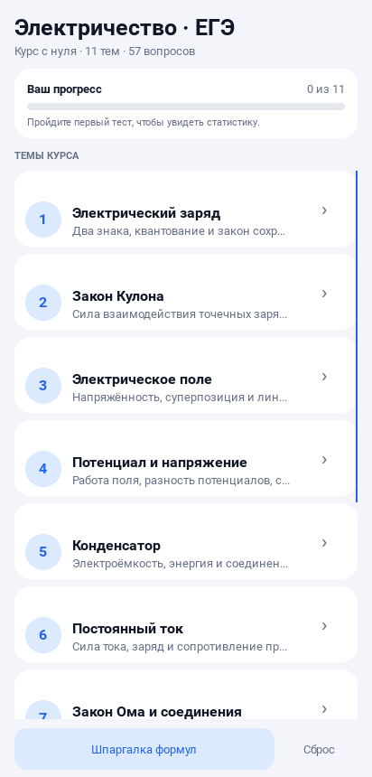
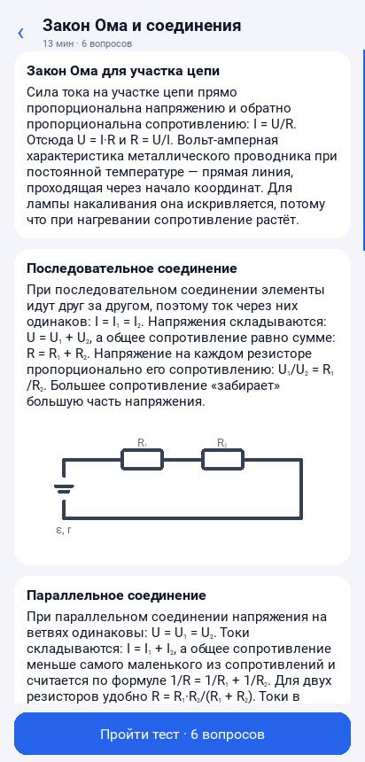
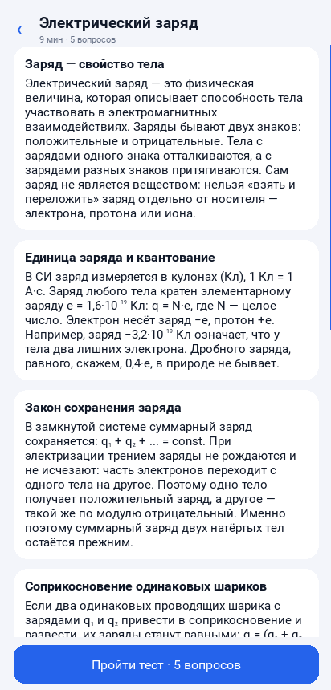
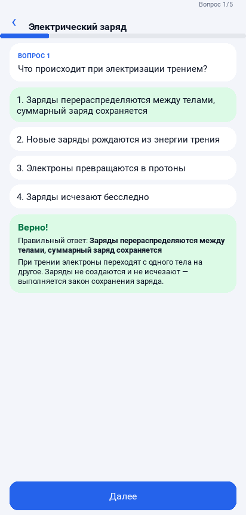
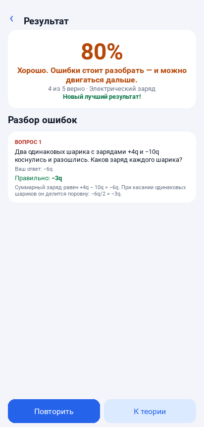

# Электричество · ЕГЭ

Мобильное приложение на Python (Kivy) для подготовки к ЕГЭ по физике по теме
«Электричество» — с нуля: короткая теория, формулы, разобранные примеры и
тесты с проверкой и разбором ошибок. Интерфейс рассчитан на телефон, но
запускается и на компьютере.

Курс: **11 тем · 57 вопросов · 31 разобранный пример · 32 формулы в шпаргалке**.
Прогресс сохраняется локально в SQLite. Приложение не требует интернета.



## Что умеет

- **Теория с нуля** — 46 разделов: от «что такое заряд» до ЭДС и тока в средах.
- **Короткие формулы** — в каждой теме есть блок «Формулы темы», плюс отдельная
  шпаргалка со всеми формулами курса.
- **Разобранные примеры** — 31 задача с «Дано», шагами решения и ответом.
- **Тесты** — 57 вопросов: выбор варианта и ввод числа. Ответ проверяется сразу,
  показывается правильный вариант и объяснение, в конце — процент и разбор
  ошибок.
- **Подсказки** — к каждому вопросу, если нужно подтолкнуть, а не подсказывать
  готовый ответ.
- **Прогресс** — лучший результат по каждой теме, общий процент, сброс прогресса.
- **Схемы цепей** — последовательное/параллельное соединение и цепь с ЭДС
  рисуются векторно, без картинок.



| Теория | Тест | Результат |
| --- | --- | --- |
|  |  |  |

## Быстрый старт на компьютере

Нужен Python 3.10+ (проверено на 3.12).

```bash
python -m venv .venv
# Windows: .venv\Scripts\activate
# Linux/macOS:
source .venv/bin/activate

pip install -r requirements.txt
python main.py
```

На Windows при первом запуске Kivy может запросить разрешение на создание
папки конфигурации — это нормально. Если хочется проверить приложение без
записи в домашнюю папку, задайте каталог данных:

```bash
# Windows PowerShell
$env:EGE_USER_DIR = "$PWD\.local-data"
python main.py
```

## Тесты и проверки

```bash
pip install -r requirements-dev.txt
python -m pytest
```

Покрыто 123 проверки:

- разбор чисел (`2,5`, `0,6`, `2·10^-3`, `2.5e-3`), формат ответов;
- проверка Kivy-разметки до запуска интерфейса;
- все 57 вопросов и 31 пример: у числовых ответов заново считается формула и
  сравнивается с JSON (защита от арифметических опечаток);
- целостность индекса, уникальность id, количество вопросов;
- кэш уроков не превышает лимит, у моделей есть `__slots__`;
- логика теста (ответы, переходы, запрет двойной отправки, разбор ошибок);
- SQLite: рекорды, проценты, сохранение между запусками, сброс;
- что в JSON нет битой разметки и «заглушек» в объяснениях.

Дополнительно:

```bash
python tools/check_content.py   # проверить весь контент, не запуская UI
python tools/memory_report.py   # замерить память ленивой загрузки
python tools/ui_smoke.py        # прогнать UI и сделать скриншоты в .ui-shots
```

`ui_smoke.py` — вспомогательный скрипт: проходит тему, отвечает на вопросы,
проверяет переходы «назад» и сохраняет скриншоты. В обычной сборке он не нужен.

## Сборка APK для Android

Подробная пошаговая инструкция (включая установку APK на телефон, разрешения
Android и разбор ошибок) — в [docs/ANDROID.md](docs/ANDROID.md).

Самый простой путь на Windows — **GitHub Actions**: загрузите проект в репозиторий,
и готовый workflow `.github/workflows/build-apk.yml` соберёт APK в облаке.
APK скачивается со страницы запуска и устанавливается на телефон.

Если хочется собирать локально, Kivy-приложения собираются на Linux (на Windows
удобно через WSL2). Нужны Java 17, Android SDK/NDK — их скачает buildozer при
первой сборке.

```bash
# внутри WSL2/Linux, в каталоге проекта
sudo apt update
sudo apt install -y git zip unzip openjdk-17-jdk python3-pip python3-venv \
    autoconf libtool pkg-config zlib1g-dev libncurses5-dev \
    libncursesw5-dev libtinfo6 cmake libffi-dev libssl-dev
python3 -m venv ~/.venv-buildozer
source ~/.venv-buildozer/bin/activate
pip install "buildozer==1.5.0" "cython<3"

buildozer -v android debug
```

Готовый файл появится в `bin/<package.name>-<version>-arm64-v8a-debug.apk`.
Первая сборка долгая: скачиваются SDK, NDK и собираются зависимости.

Для Android зафиксирована проверенная связка: p4a `v2024.01.21`, Python 3.11,
Kivy 2.3.0, NDK 25b, API 33. Более новые p4a используют Python 3.14, под который
старые pyjnius/Kivy ещё не собраны, поэтому не меняйте эти версии без
необходимости. На компьютере можно ставить `kivy==2.3.2` из `requirements.txt`.

## Как устроен проект

```
main.py                  запуск Kivy-приложения, настройки окна/памяти
app/
  config.py              пути, лимит кэша, порог «темы пройдена»
  models.py              Lesson, Question, Section… — все с __slots__
  content.py             ленивая загрузка JSON + строгая валидация
  formulas.py            физические формулы и пересчёт ответов
  units.py               парсинг/формат чисел (запятая, степени 10)
  markup.py              проверка [b]/[sub]/[sup]/[color] до запуска UI
  storage.py             SQLite: попытки, лучший результат
  quiz.py                сессия теста, подсчёт, разбор ошибок
  ui/
    theme.py             палитра, размеры, шрифты
    widgets.py           карточки, кнопки, прогресс, схемы (canvas)
    screens.py           главная, теория, тест, результат, шпаргалка
    app.py               ScreenManager, навигация, lifecycle
data/
  index.json             список тем
  lessons/*.json         по одному файлу на тему
  formulas.json          шпаргалка
tests/                   123 pytest-проверки
tools/                   проверка контента, память, UI-прогон, скриншоты
docs/ANDROID.md          как собрать APK и установить на телефон
.github/workflows/       готовая сборка APK в GitHub Actions
buildozer.spec           конфигурация Android-сборки
```

### Контент

Урок — обычный JSON. Числовые примеры и ответы содержат машиночитаемое поле
`calc`: при загрузке приложение заново считает значение по формуле и падает с
понятной ошибкой, если в тексте опечатка. Поэтому «ответы в тестах» не могут
разойтись с формулами незаметно.

```json
{
  "id": "coulomb",
  "title": "Закон Кулона",
  "sections": [{"h": "Формулировка", "p": "F = k·|q[sub]1[/sub]q[sub]2[/sub]|/r[sup]2[/sup]"}],
  "formulas": [{"name": "Закон Кулона", "expr": "F = k·|q[sub]1[/sub]q[sub]2[/sub]|/r[sup]2[/sup]", "note": "k = 9·10[sup]9[/sup]"}],
  "examples": [{
    "title": "Сила между зарядами",
    "given": "q1 = 2 мкКл, q2 = 3 мкКл, r = 30 см",
    "steps": ["Переводим в СИ", "F = ...", "F = 0,6 Н"],
    "answer": "F = 0,6 Н",
    "calc": {"formula": "coulomb_force", "args": {"q1": 2e-6, "q2": 3e-6, "r": 0.3}, "value": 0.6}
  }],
  "questions": [{
    "id": "coulomb-q1",
    "kind": "numeric",
    "text": "Найдите силу в ньютонах",
    "answer": 0.2,
    "unit": "Н",
    "calc": {"formula": "coulomb_force", "args": {"q1": 1e-6, "q2": 2e-6, "r": 0.3}},
    "explanation": "F = ...",
    "hint": "Переведите микрокулоны в кулоны"
  }]
}
```

После правки: `python tools/check_content.py && python -m pytest`.

## Память: что именно оптимизировано

Приложение не грузит весь курс сразу и не держит виджеты невидимых экранов.

- **Ленивая загрузка уроков.** В памяти одновременно не больше 2 уроков
  (`CONTENT_CACHE_LIMIT`), при уходе с экрана кэш освобождается. Замер на этом
  контенте: все 11 уроков сразу — **≈223 КиБ** python-кучи, ленивый обход с
  кэшем 1 — **≈35 КиБ** (пик ≈90 КиБ). Экономия ≈85 % по контенту.
- **`__slots__` у всех моделей.** Нет `__dict__` на каждый урок/вопрос/пример.
- **Список тем без пересоздания.** 11 строк создаются один раз при сборке
  главного экрана; при возврате обновляются только проценты. Тяжёлые тексты
  уроков при этом не создаются и не живут одновременно.
- **Уничтожение тяжёлого контента.** После перехода (через 0,24 с, когда
  закончилась анимация) у экрана вызывается `release()`: очищаются Label-ы,
  карточки, варианты ответов, разбор ошибок; кэш урока освобождается. Поэтому
  длинная теория и тест не висят в памяти одновременно.
- **Никаких растровых ассетов.** Иконки — символы, схемы — `Line`/`Rectangle`,
  фоны — `RoundedRectangle`. Нет текстур картинок, нет `pillow`.
- **Меньше памяти GPU.** В `main.py` отключено MSAA (`multisamples = 0`):
  минус буфер сглаживания, на тексте это не заметно.
- **SQLite настроен экономно.** Кэш страниц 256 КиБ вместо ~2 МиБ,
  `temp_store=FILE`, `mmap_size=0`; прогресс не дублируется в списках Python.
- **`gc.freeze()` после старта.** Стартовые объекты не сканируются сборщиком
  на каждой сборке — меньше рывков. `gc` остаётся включённым.
- **Пресеты Kivy.** `KIVY_NO_ARGS=1`, фиксированный размер окна на десктопе.

Важно: основной расход RAM на телефоне — это сам Kivy/OpenGL и текстуры
видимого текста, а не JSON-контент. Указанные меры убирают лишние копии
контента и жизни виджетов, но не могут сделать Kivy легче Flutter.

## Android-особенности

- Кнопка «назад»: тест → теория (контент пересобирается), теория/результат →
  главная, на главной — выход.
- `on_pause` закрывает SQLite, `on_resume` открывает заново: данные не теряются.
- Поле ввода числа показывает цифровую клавиатуру; поддерживаются `,`, `.`,
  `e`, `10^`.
- Если база недоступна, приложение продолжает работать без сохранения
  прогресса (in-memory), а не падает.

## Ограничения

- Нет облачной синхронизации и аккаунтов — прогресс только на устройстве.
- Нет генератора случайных задач: база вопросов фиксированная (57), но
  порядок вопросов перемешивается при каждом прохождении.
- Интерфейс на русском, тема — электричество; остальные разделы ЕГЭ не входят.
